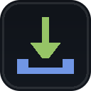

<h1 align="center">ZVLZ OmniFetch</h1>

<p align="center">
  
</p>

<p align="center">
  A Chrome extension that downloads media from the active tab, only when the file is complete.
</p>

<p align="center">
  
  
  
  
</p>

## Install

1. Download or clone this repository.
2. Open `chrome://extensions` in Chrome 120 or later.
3. Turn on **Developer mode**.
4. Choose **Load unpacked**, then select the folder that contains `manifest.json`.
5. Reload the page, play the media, then open the extension.

## How to use

Open the extension on a page with media. You will see a list of videos, audio, and images from that tab.

- Hover a video to preview it.
- Click **Download** on an item to save it.
- Items that are not ready appear under Unavailable, with a reason.
- Use the Queue view to pause, resume, or cancel a download.
- Use the History view to see past downloads.

Results belong to the active tab. Switching tabs shows that tab's results. Results are cleared when the browser closes.

## What you can download

- HLS videos, saved as MP4
- DASH videos, saved as MP4
- Progressive video and audio files
- Images, one by one or as a ZIP
- Video with its matching audio track, saved as one file

## What is not supported

- DRM protected streams
- Incomplete streams, which stay under Unavailable instead of saving a broken file
- Live streams as a full download. Live streams can only be recorded from the moment you start recording.

## Privacy

Everything runs in your browser. There is no account and no server.

## For developers

Run the tests with:

```
npm test
```

The code is organized into `background`, `content`, `engine`, `offscreen`, and `ui`. Icons are in `icons`.

## License

MIT. Created by Zivalez.
